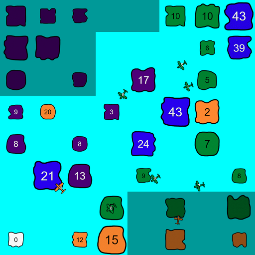

# Archipelago

A web-based multiplayer clone of the [android game](https://play.google.com/store/apps/details?id=com.sgg.archipelago_kr) 
with the same name.



[](https://github.com/verath/archipelago/actions/workflows/ci.yml)

The game can be played at https://playarchipelago.com.

## The Archipelago game

The game is about controlling islands by sending airplanes. Each players starts controlling a single 
island. In addition, there are multiple islands, controlled by neither player. Each island
has an army, that for player-controlled islands increases over time. A player may at anytime
choose to send an airplane from an island that the player controls to any other island. The airplane 
is created with half the army strength of the island, subtracted from the island.

As an airplane reaches its destination different things happen:
  1. If the owner of the airplane is the same as the owner of the island, then the island strength is 
  increased by the strength of the army on the airplane.
  2. If the owner is not the same, then the army size of the island is subtracted by the army size of 
  the airplane. This in turn can have additional effects:
     1. If the resulting island army size is `<0`, then the player controlling the airplane gets 
     control of the island and the army size of the island is set to the absolute value.
     2. If the resulting island army size is `== 0`, then control of the island is given to the 
     neutral player.

The game is over when there is only a single player controlling any islands or airplanes.

## Project Overview

The project has two parts; A backend server written in go, and a frontend written in TypeScript. 
Communication between the backend and frontend is done over binary WebSockets messages, serialized
using protocol buffers defined in the [proto](./proto) directory.

### Frontend

The frontend project is found in the [web](./web) directory. It is written in
[TypeScript](https://www.typescriptlang.org/) and uses [Pixi.js](https://pixijs.com/) 8 for WebGL
rendering and [React](https://react.dev/) 19 for the UI around the game. Dependencies are managed
with npm and the app is bundled with [Vite](https://vite.dev/). Vite only strips the types;
`npm run typecheck` in `web/` runs the TypeScript compiler (`tsc`) to check them.

### Backend

The backend is written in Go and uses Go modules. It relies primarily on the Go standard library
(including `log/slog` for logging) and uses [gorilla/websocket](https://github.com/gorilla/websocket)
for WebSocket handling.

The backend code is found in the [lib](./lib) directory.

## Running the Project

To build and run the project, install:
* [Go](https://go.dev/dl/) (the version in `go.mod`; with the default `GOTOOLCHAIN=auto` an older
  Go downloads it automatically)
* [Node.js](https://nodejs.org/en/download/) 24 or newer (npm is included)

Then clone the project and install the frontend dependencies:

```
git clone git@github.com:verath/archipelago.git
cd archipelago/web
npm ci
```

Run the backend from the repository root. It only serves the game WebSocket; the frontend is
served by Vite:

```
go run main.go -debug -skipWSOriginCheck
```

Then, in `web/`, start the Vite dev server:

```
npm run dev
```

The game is then available at [http://localhost:5173](http://localhost:5173). Vite reloads on
changes and proxies the game WebSocket (`/app/ws`) to the backend on port 8080.

To try the production build instead, run `npm run build && npm run preview` and open
[http://localhost:4173](http://localhost:4173). The preview proxies the WebSocket the same way.

## Developing

### Checks and tests

These run in CI ([.github/workflows/ci.yml](.github/workflows/ci.yml)) on every push and pull request:

```
go vet ./...
go test -race ./...      # -race needs cgo, i.e. a C compiler
cd web && npm run lint && npm run typecheck && npm test && npm run build
cd web && npm run test:e2e
```

* **Backend unit tests:** `go test ./...`.
* **Frontend unit tests** ([Vitest](https://vitest.dev/)): `npm test` in `web/` (or
  `npm run test:watch`). Tests live next to the code as `*.test.ts(x)` and cover the game models,
  the WebSocket connection, the game controller, the React UI and the protobuf bundle.
* **End-to-end tests** ([Playwright](https://playwright.dev/), Chromium): `npm run test:e2e` in
  `web/`. Before the first run, install the browser with `npx playwright install chromium`. The
  suite builds the Go backend and both frontend builds itself (note: this overwrites `web/dist`),
  then plays real games against a backend started per test. The tests check that:
  * the production build loads under the CSP from `web/firebase.json`;
  * a game against AI starts;
  * launching an airplane works;
  * the remaining player wins when the other one leaves;
  * the UI copes with the backend going away.

  Specs are in [web/e2e](web/e2e). On failure, `npx playwright show-report` opens the report.

The e2e tests use a test build (`npm run build:e2e`, output in `web/dist-e2e`) that exposes a
read-only `window.__archipelagoTest` hook; production builds don't contain it. Both builds are
served by `vite preview` with the headers (incl. the CSP) from `web/firebase.json`. The tests also
use backend flags that make test games fast and predictable:

* `-lobbyWait <duration>`: how long to wait for more players before starting a game (default
  `8s`).
* `-aiPlayers <n>`: `-1` fills each game up to 4 players (default), `0` adds no AI, so a game
  needs 2 humans; `n` adds exactly `n` (at most 10).

### Protocol Buffers (protobuf)

The wire format is defined in [proto](./proto). To regenerate the Go (`.pb.go`) and JavaScript
(`.js`, `.d.ts`) files, install the protobuf compiler (`protoc`) and the Go plugin
(`go install google.golang.org/protobuf/cmd/protoc-gen-go@latest`), make sure both are on the
`PATH`, and run from `web/`:

```
npm run proto
```

The JavaScript tooling (protobufjs-cli) is installed by `npm ci`.

## Deployment

Pushes to `master` deploy automatically after CI passes, but only the half that changed:

* **Backend** → [Fly.io](https://fly.io) (`ws.playarchipelago.com`), built from the
  [Dockerfile](Dockerfile) and configured in [fly.toml](fly.toml). It runs on a single machine,
  because game state lives in memory. The machine is suspended when idle and resumes on the next
  connection. To deploy by hand, run `fly deploy` from the repository root.
* **Frontend** → Firebase Hosting (`playarchipelago.com`), configured in
  [web/firebase.json](web/firebase.json). To deploy by hand, run `npm run deploy` in `web/` after
  `npm run build`.

The CI workflow can also be run manually on `master` with "deploy" ticked to deploy both.

Dependencies are kept up to date by Dependabot. Minor and patch updates are merged automatically
once CI passes, and major updates are left for review. Those automatic merges don't trigger a
deploy (GitHub doesn't run workflows for pushes made with the workflow token). They go out with
the next normal push to `master`, or a manual run with "deploy" ticked.
